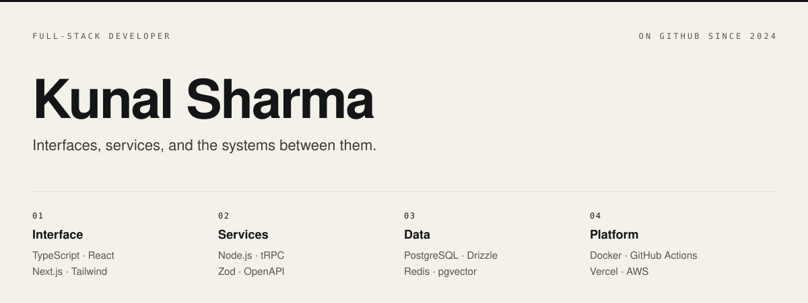

<!--
  GitHub profile README for kunalsharmagithb.
  Header art: assets/header-light.svg and assets/header-dark.svg.
  Email, LinkedIn, and site links are commented under Connect. Add the real URLs before publishing.
-->

<picture>
  <source media="(prefers-color-scheme: dark)" srcset="./assets/header-dark.svg">
  
</picture>

I build full-stack products from the interface to the database. Types carry the contract the whole way. Traces show whether the design holds once real traffic arrives.

## Stack

**TypeScript**
One language from the UI to the query layer, so the contract cannot drift in silence.

**React · Next.js · Tailwind CSS**
Server-rendered product UI, a small styling system, and interaction states that include loading, empty, and error.

**Node.js · tRPC · Zod**
Inputs and outputs checked at the boundary and shared with the client. OpenAPI when a contract has to leave the repo.

**PostgreSQL · Drizzle · Redis**
Relational data as the source of truth, a typed query layer, and cache only where latency earns it.

**Vercel AI SDK · pgvector**
Streaming AI features grounded in product data, with retrieval stored beside the records it cites.

**Vercel · Docker · GitHub Actions · AWS**
The product surface on Vercel, workers in containers, reviewable builds in Actions, and durable storage and queues on AWS.

**Vitest · Playwright · OpenTelemetry**
Unit tests for logic, browser tests for flows, and traces for behavior that only appears in production.

## How I work

- **Domain model first.** Screens follow the data and the states that data can be in.
- **Failure ships with the feature.** Loading, empty, and error are specified with the happy path.
- **Narrow contracts.** A small API stays reviewable and difficult to misuse.
- **Evidence before tuning.** Timings and traces decide what is worth making faster.

## Now

- Publishing selected builds in public repositories
- Designing AI features that stay inside real product flows
- Keeping the interface and the service layer on one type system

## Connect

- [GitHub](https://github.com/kunalsharmagithb)

<!--
- [Email](mailto:hello@yourdomain.com)
- [LinkedIn](https://www.linkedin.com/in/your-handle)
- [Web](https://yourdomain.com)
-->

Full toolchain

| Concern | Tools |
| --- | --- |
| Language | TypeScript |
| Interface | React, Next.js, Tailwind CSS, Motion, Radix UI |
| API | Node.js, tRPC, Zod, OpenAPI |
| Data | PostgreSQL, Drizzle, Redis, pgvector |
| Intelligence | Vercel AI SDK, streaming UI, retrieval, evals |
| Auth | Better Auth |
| Platform | Docker, GitHub Actions, Vercel, AWS |
| Quality | Vitest, Playwright, OpenTelemetry |
| Repo | pnpm, Turborepo |

Kunal Sharma · Full-stack developer
